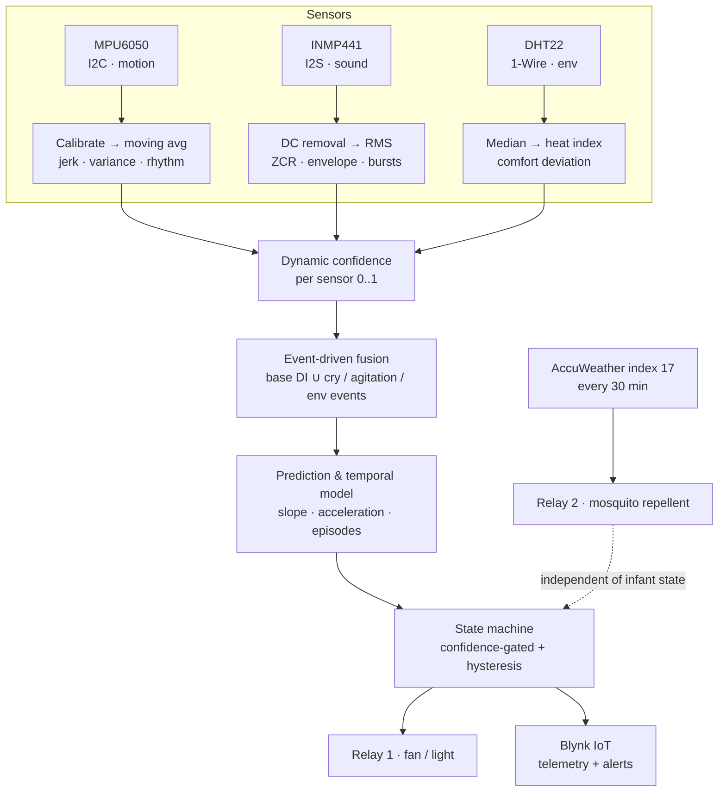
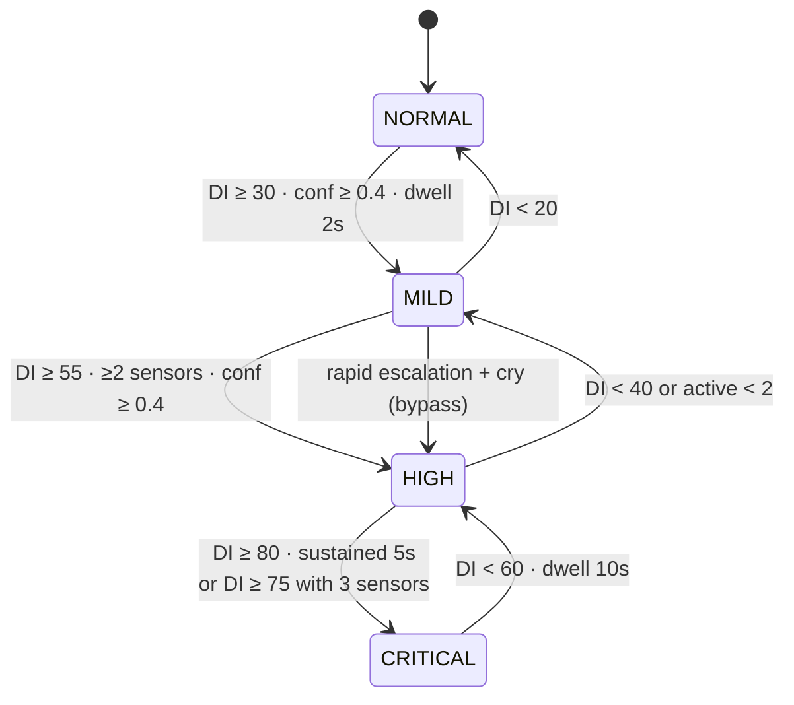

<div align="center">

# LullabyGuard

### Smart Infant Monitoring System — edge-only multi-sensor fusion on ESP32-S3


**Crying · Restlessness · Heat stress · Mosquito risk — fused into one calm, explainable signal.**

</div>

---

## Why this exists

A baby cannot tell you it is uncomfortable. LullabyGuard watches three independent
signals — **sound**, **motion**, and **environment** — and combines them into a single
**Discomfort Index (DI, 0–100)** that drives a four-state safety machine. Everything runs
on-device: no cloud inference, no camera, no microphone recording leaving the ESP32.
An independent mosquito-risk loop polls AccuWeather and controls a second relay without
ever consulting the infant state.

> ⚠️ **This is a monitoring aid, not a medical device.** It must never replace supervision
> or clinical judgement.

---

## Features

| | Capability | What it does |
|---|---|---|
| 🔊 | **Cry detection** | INMP441 + I2S → DC-removed RMS, adaptive noise floor, ZCR, energy variance, burst counting, 2 s sustain |
| 🛌 | **Motion & rhythm rejection** | MPU6050, gyro-gated scoring, jerk / variance / autocorrelation to reject fan or rocker vibration |
| 🌡️ | **Environmental comfort** | DHT22 median filter + NWS heat index (Rothfusz regression), Euclidean norm over temperature and humidity |
| 🧠 | **Event-driven fusion** | Confidence-weighted base DI, multi-signal event corroboration, temporal slope / acceleration / episode intensity |
| 🔁 | **Hysteretic state machine** | `NORMAL → MILD → HIGH → CRITICAL` with confidence-gated escalation and dwell timers |
| 📡 | **Blynk telemetry & alerts** | Nine virtual pins, event-aware notifications, offline alert queue with replay on reconnect |
| 🦟 | **Independent mosquito loop** | AccuWeather index poll every 30 min, hysteresis relay control, 2 h stale → safe default |
| ⚡ | **Adaptive power** | State-driven sampling, NORMAL-state WiFi duty cycling, conservative light sleep |
| 🛡️ | **Graceful degradation** | Per-sensor health, dynamic confidence, degraded mode, latched SAFE_HALT that forces both relays off |

---

## Architecture



### State machine



De-escalation is always allowed regardless of confidence — safety first. Escalation
requires confidence ≥ 0.4 so a noisy or failed sensor cannot raise a false alarm.

---

## Hardware

### Bill of materials

| Qty | Part | Notes |
|---|---|---|
| 1 | ESP32-S3-WROOM-1 dev board | Arduino core `esp32:esp32` 3.3.12 |
| 1 | MPU6050 | 6-axis IMU, I2C address `0x68` |
| 1 | DHT22 / AM2302 | Temperature + humidity |
| 1 | INMP441 | I2S MEMS microphone |
| 2 | GPIO relay modules | Active-LOW inputs, fan/light + repellent |
| 1 | Mosquito repellent actuator | Rated for the relay load |
| 1 | 5 V supply | Adequate for ESP32 + relays |
| — | Pull-ups, wiring, enclosure | I2C pull-ups if the board lacks them |

### Pinout

| Component | Signal | GPIO |
|---|---|---|
| MPU6050 | SDA | **8** |
| MPU6050 | SCL | **9** |
| DHT22 | DATA | **4** |
| INMP441 | SCK | **40** |
| INMP441 | WS | **39** |
| INMP441 | SD | **41** |
| Relay 1 | Fan / light | **6** |
| Relay 2 | Mosquito repellent | **7** |

Relays are **active LOW**: `LOW = ON`, `HIGH = OFF`. Both are forced OFF at boot and
on SAFE_HALT. Connect mains loads only with appropriate fusing and insulation.

---

## Quick start

### 1. Clone

```bash
git clone https://github.com/041rayan/LullabyGuard.git
cd LullabyGuard
```

> The sketch file must sit in a folder named `LullabyGuard` for Arduino tooling.

### 2. Install credentials

```bash
cp secrets.example.h secrets.h
$EDITOR secrets.h          # fill in your own values
```

`secrets.h` is gitignored. **Never commit it.**

<details>
<summary><b>Where to get each value</b></summary>

| Macro | Source |
|---|---|
| `BLYNK_AUTH_TOKEN` | Blynk.Console → Device → Device Info → Auth Token |
| `WIFI_SSID` / `WIFI_PASS` | Your 2.4 GHz WiFi network |
| `ACCUWEATHER_API_KEY` | [AccuWeather developer portal](https://developer.accuweather.com/) → My Apps |

Keep `BLYNK_TEMPLATE_ID`, `BLYNK_TEMPLATE_NAME`, `ACCUWEATHER_LOCATION` (default `29075`)
and `MOSQUITO_INDEX_ID` (default `17`) in the sketch — they are configuration, not secrets.

</details>

> 🔑 **Credential rotation required.** The original development sketch contained live
> Blynk, WiFi, and AccuWeather credentials before secrets were externalised. Treat all
> three as exposed: rotate the Blynk token, regenerate the AccuWeather key, and change
> the WiFi password before deploying.

### 3. Build

Reproducible build profile (Arduino CLI):

```bash
arduino-cli core install esp32:esp32@3.3.12
arduino-cli compile --profile default
```

Or without a profile:

```bash
arduino-cli compile --fqbn esp32:esp32:esp32s3 LullabyGuard
```

Arduino IDE: install the **esp32** board package (3.3.12), install the libraries listed
in `sketch.yaml`, open `LullabyGuard.ino`, select **ESP32S3 Dev Module**, then compile.

### 4. Flash & monitor

```bash
arduino-cli upload --profile default -p /dev/ttyUSB0
arduino-cli monitor -p /dev/ttyUSB0 -c baudrate=115200
```

The serial console prints a full status frame every 5 s: scores, confidence, DSP
features, active events, temporal state, relay state, and sensor health.

---

## Blynk dashboard

Create a device from template `TMPL66yk5T8ys` (or your own) and add these datastreams:

| Virtual pin | Datastream | Type | Meaning |
|---|---|---|---|
| V0 | Discomfort Index | Double | Smoothed DI, 0–100 |
| V1 | State | Integer | 0 NORMAL · 1 MILD · 2 HIGH · 3 CRITICAL |
| V2 | Temperature | Double | °C |
| V3 | Humidity | Double | %RH |
| V4 | Sound level | Double | 0–100 |
| V5 | Motion level | Double | 0–100 |
| V6 | Mosquito index | Double | 0–10 |
| V7 | Fan override | Integer | 1 auto · 2 force OFF · 3 force ON |
| V8 | Mosquito override | Integer | 1 auto · 2 force OFF · 3 force ON |
| V9 | Prediction slope | Double | DI units per sample |

Create these **events** in Blynk so notifications render correctly:

`high_discomfort`, `critical_alert`, `recovered`, `trend_warning`,
`rapid_escalation`, `system_fault`, `degraded_mode`, `system_recovered`.

Alerts raised while offline are queued (8 slots, oldest overwritten) and replayed on
reconnect.

---

## Calibration & runtime behaviour

| Stage | What happens |
|---|---|
| Boot — MPU6050 | 10 s stillness calibration, 500 samples, burst-read of all 6 axes |
| Boot — INMP441 | 5 s I2S settling flush, then 3 s noise-floor measurement; floor = base RMS × 1.5 |
| Boot — DHT22 | Last valid reading reused for up to 60 s if a read fails |
| Every cycle | Confidence EMA: −0.005/cycle on stale data, +0.02/cycle on good data |
| Fusion | DI = EMA(0.3) of `max(base, events) + temporal + episode` boosts |
| State dwell | 2 s minimum; 10 s minimum in CRITICAL |
| Relay debounce | 5 s minimum between toggles |

### Adaptive sampling

| State | Sensor interval | WiFi | Blynk updates |
|---|---|---|---|
| NORMAL | 5000 ms | 30 s on / 5 min cycle | 30 s |
| MILD_DISCOMFORT | 2000 ms | always on | 15 s |
| HIGH_DISCOMFORT | 500 ms | always on | 5 s |
| CRITICAL | 250 ms | always on | 5 s |

In NORMAL the loop also enters timer-based light sleep between samples whenever the
radio is off. Set `ENABLE_LIGHT_SLEEP 0` to disable it.

---

## Verification

```bash
bash scripts/verify.sh
```

Runs static invariants (no credentials in source, duty-cycle constants, sleep gating,
alert queue, SAFE_HALT ordering) plus a full `arduino-cli` compile.

---

## Known discrepancies & limitations

- **Comfort constants differ from the design document.** The firmware uses
  **24–30 °C / 50–70 % RH** with max deviations **8 °C / 30 % RH**; the system design
  document specifies **20–26 °C / 40–60 % RH** with **6 °C / 20 % RH**. The firmware
  values are retained as likely deliberate tropical tuning — confirm before changing.
- **GPIO sound-threshold wake source is not implemented.** Light sleep is timer-driven
  only; waking on an I2S threshold needs external interrupt wiring that is not specified.
- **No deep sleep.** RTC/state loss would reset the system; this is intentional.
- **No over-the-air updates or device-side configuration portal.** Credentials are
  compile-time.
- **Mosquito safe default is dual.** Stale API data sets the index to moderate (0.5)
  while the relay logic turns ON after 2 h without valid data.

Full algorithm details live in
[`LullabyGuard_SystemDesign.md`](LullabyGuard_SystemDesign.md). Design and implementation
records are under [`docs/superpowers/`](docs/superpowers/).

---

## Troubleshooting

| Symptom | Check |
|---|---|
| `[WIFI] Failed` repeatedly | 2.4 GHz network, SSID/password in `secrets.h`, retry backoff of 5 min |
| `[MPU] FATAL: Init failed` | I2C wiring on GPIO 8/9, address `0x68`, pull-ups |
| Sound score always 0 | INMP441 SCK/WS/SD on 40/39/41, 5 s settle + 3 s calibration, check `noise floor` in serial output |
| DHT values stuck | Minimum 2 s between reads; last valid value reused for 60 s |
| No Blynk data | Auth token, template ID, dashboard datastreams, NORMAL duty-cycle window (up to 5 min) |
| `Adafruit_Sensor.h: No such file` | Install `Adafruit Unified Sensor` (already pinned in `sketch.yaml`) |
| Compile fails with legacy I2S error | Use ESP32 core 3.3.12 as pinned in `sketch.yaml` |
| Relays stuck OFF | SAFE_HALT is latched after 3 sensor failures; it clears when fewer than 2 remain failed |

---

## Contributing

Issues and pull requests are welcome. Please:

1. Run `bash scripts/verify.sh` before opening a PR.
2. Keep changes allocation-free and single-threaded — see the design constraints.
3. Never add credentials to tracked files.

## Licence

[MIT](LICENSE) © 2026 LullabyGuard contributors.

<div align="center">

*Built for quieter nights and calmer mornings.*

</div>
